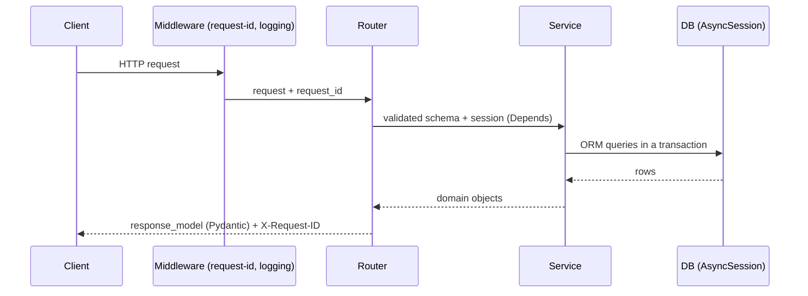

# Backend Architecture (FastAPI)

Stack: Python 3.13+, FastAPI, Pydantic v2, pydantic-settings, SQLAlchemy 2.0 async (`asyncpg`), uvicorn,
Flyway, uv. Gates: [05-quality-gates.md](../05-quality-gates.md#backend).

## Layers and responsibilities

| Layer | Folder | Does | Must not |
|-------|--------|------|----------|
| Entry | `app/main.py` | `create_app()` factory: middleware, exception handlers, `include_router(api_router)`, lifespan (DB engine) | Contain routes or business logic |
| Routing | `app/api/routes.py`, `app/api/router/<domain>.py` | HTTP concerns: path, status codes, request/response schemas, `Depends` | Run SQL or hold business rules |
| Schemas | `app/schemas/<domain>.py` | Pydantic v2 models: `<X>Create`, `<X>Update`, `<X>Read`; `model_config = ConfigDict(from_attributes=True)` | Import ORM models |
| Services | `app/services/<domain>.py` | Business logic; transactions; raise domain exceptions | Import `fastapi` or return HTTP responses |
| Models | `app/models/<aggregate>.py` | SQLAlchemy 2.0 `Mapped[...]` declarative models | Hold business logic |
| Core | `app/core/` | `config.py` (Settings), `db.py` (engine/session), `logging.py`, `errors.py`, `middleware.py` | Depend on domain modules |
| Helpers | `app/helpers/` | App-aware reusable glue: pagination, sorting, query filters | Be imported by `utils/` |
| Utils | `app/utils/` | Pure functions with no `app.*` imports: dates, strings, hashing | Import anything from `app` |

Dependency direction: `api → services → models`. `schemas` is used by `api` and `services`. Everything may
use `core`, `helpers` and `utils`. Import-linter (or a pylint plugin rule) can enforce this from M2.

## Request flow

## Conventions

- **Versioned API:** all routes are mounted at `/api/v1`. Breaking changes go to a new version.
- **Dependency injection:** `get_session()`, `get_settings()` and `get_current_user()` (placeholder) live in
  `app/api/deps.py`. Tests override them with `app.dependency_overrides`.
- **Async all the way:** async route handlers and async SQLAlchemy. Never block the event loop; wrap blocking
  calls in `run_in_threadpool`.
- **Errors:** services raise `NotFoundError`, `ConflictError` or `ValidationError` from `app/core/errors.py`.
  One exception handler maps them to the envelope and HTTP status.
- **Docstrings:** numpy style on every public module, class and function. Enforced by pylint `docparams`, see
  [quality gates](../05-quality-gates.md#backend).
- **Typing:** full annotations; mypy `--strict`. No `Any` in service signatures.
- **Health:** `GET /health` (liveness, no dependencies) and `GET /ready` (checks the DB).

## Testing strategy

| Level | Location | Tooling | Scope |
|-------|----------|---------|-------|
| Unit | `tests/unit/` | pytest, pytest-asyncio | Services and utils with fakes; no DB |
| Integration | `tests/integration/` | `httpx.AsyncClient` + `ASGITransport`, Testcontainers Postgres + Flyway | Routes end-to-end against real Postgres |
| Contract | `tests/integration/test_openapi.py` | Snapshot of `/openapi.json` | Detects unintended API changes |
| Drift | `tests/integration/test_schema_drift.py` | SQLAlchemy inspector vs `Base.metadata` | ORM matches Flyway schema |

Fixtures live in `tests/fixtures/` (factories, sample payloads). `conftest.py` provides `app`, `client` and a
transactional `session` that rolls back per test. Tests reference Jira acceptance criteria with
`@pytest.mark.ac("AIFS-0001", "AC-1")`; see [jira-workflow.md](../04-spec-driven-development/jira-workflow.md#traceability).
