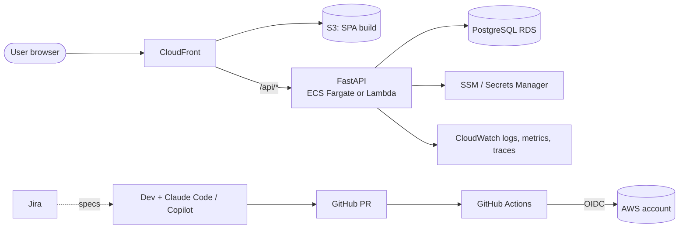

# Architecture Overview

## System context



- The SPA is static (S3 + CloudFront). It calls the API under the same origin (`/api/*` routed by CloudFront),
  which avoids CORS in deployed environments.
- The API is stateless. State lives in Postgres. Migrations are Flyway SQL ([ADR-0004](../adr/0004-flyway-over-alembic.md)).
- The contract between the two is the **FastAPI OpenAPI schema**. The frontend's typed client is generated
  from it, and CI fails if the generated client is stale.

## Repository layout

The user-specified structure, with the deviations listed below applied.

```text
.
├── CLAUDE.md                     # lean repo-wide AI context (≤150 lines)
├── README.md  CONTRIBUTING.md  LICENSE  .editorconfig  .gitignore  .pre-commit-config.yaml  justfile
├── .claude/                      # settings.json, rules/, skills/, agents/, hooks/
├── .github/                      # workflows/, CODEOWNERS, copilot-instructions.md, PR/issue templates
├── .vscode/                      # extensions.json, settings.json, launch.json, mcp.json
├── .mcp.json                     # Claude Code MCP servers (Jira)
├── backend/
│   ├── CLAUDE.md                 # backend-only AI context (loads on demand)
│   ├── pyproject.toml  uv.lock  Dockerfile  .env.example
│   ├── db/migrations/            # Flyway V*.sql / R__*.sql
│   ├── src/app/
│   │   ├── main.py               # app factory, middleware, router mount
│   │   ├── core/                 # config (pydantic-settings), db session, logging, errors
│   │   ├── api/
│   │   │   ├── routes.py         # aggregates routers
│   │   │   └── router/<domain>.py
│   │   ├── models/<aggregate>.py # SQLAlchemy ORM models
│   │   ├── schemas/<domain>.py   # Pydantic v2 request/response models
│   │   ├── services/<domain>.py  # business logic
│   │   ├── helpers/              # app-aware glue (pagination, query builders)
│   │   └── utils/                # pure, app-agnostic functions
│   └── tests/
│       ├── fixtures/  conftest.py
│       ├── unit/  integration/
│       └── test_main.py  test_routes.py
├── frontend/
│   ├── CLAUDE.md
│   ├── package.json  pnpm-lock.yaml  vite.config.ts  vitest.config.ts  eslint.config.js  tsconfig.json
│   └── src/ components/ pages/ services/ hooks/ utils/ api/ (generated) tests/
├── infra/                        # IaC (ADR-0007), with its own CLAUDE.md
├── ai-enablement/                # worked examples of AI workflows (see playbook)
└── docs/                         # this blueprint
```

### Deviations from project-context.md (and why)

| # | Original | Change | Reason |
|---|----------|--------|--------|
| D1 | `src/app/main.py` beside `src/models`, `src/api`, … as top-level packages | Everything lives under **one package `app`** (`src/app/api`, `src/app/models`, …) | Top-level packages named `models`, `api` or `utils` collide with third-party names; one package gives clean `from app.services…` imports and one coverage target |
| D2 | `src/tests/` | `backend/tests/` | Keeps tests out of the shipped package and Docker image; standard pytest/coverage config |
| D3 | `models/models.py` | `models/<aggregate>.py` + `models/__init__.py` | A single file grows without limit and becomes hard for AI to edit precisely; per-aggregate files keep diffs small |
| D4 | none | Add `app/core/` | Config, DB session, logging and error handlers need a home that is neither a service nor a util |
| D5 | none | Add `infra/`, `ai-enablement/`, `backend/db/migrations/` | Required by deployment, AI-examples and Flyway requirements |
| D6 | `frontend/src/tests/` only | Co-located `*.test.tsx` **and** `src/tests/` for shared setup, MSW handlers and integration tests | Co-location is the Vitest/RTL norm and keeps a test next to the code an agent just edited |

## Cross-cutting design rules

- **Layering (backend):** router → service → model. Routers never touch the DB session directly. Services
  never import FastAPI. See [backend.md](backend.md).
- **Layering (frontend):** page → hook → service → generated client. Components never call `fetch`. See
  [frontend.md](frontend.md).
- **Contract first:** a change to API shape starts in `schemas/` and regenerates the frontend client in the
  same PR.
- **Config:** 12-factor, from environment variables only. See
  [config-and-secrets.md](../07-engineering-process/config-and-secrets.md).
- **Errors:** one error envelope `{ "error": { "code", "message", "details", "request_id" } }`, mapped from
  domain exceptions in `app/core/errors.py`.
