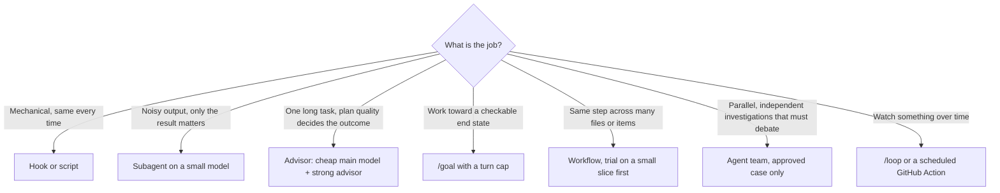

# Agents, Advisor and Supervision

Which multi-agent mechanism to use for which job, and who supervises the result. The aim is the **right tool for
the task**, not one technique applied everywhere. Sources: Anthropic docs on
[subagents](https://code.claude.com/docs/en/sub-agents), [agent teams](https://code.claude.com/docs/en/agent-teams),
the [advisor](https://code.claude.com/docs/en/advisor), [`/goal`](https://code.claude.com/docs/en/goal),
[scheduled tasks and `/loop`](https://code.claude.com/docs/en/scheduled-tasks) and
[workflows](https://code.claude.com/docs/en/workflows). Decision: [ADR-0011](../adr/0011-tiered-ai-operating-model.md).

## Choosing a mechanism

| Mechanism | Context | Cost shape | Use here for | Not for |
|-----------|---------|-----------|--------------|---------|
| **Hook / script** | None | Zero model cost | Formatting, blocking protected files, story context | Anything needing judgement |
| **Skill** | Main conversation, loaded on demand | Cheap | Repeatable procedures (spec, endpoint, migration) | Isolating verbose output |
| **Subagent** | Own window; summary returns | Low to medium, per model | Test triage, AC verification, review, broad search | Work that needs the full conversation |
| **Advisor** | Reads full transcript at decision points | Medium | Large refactors, recurring bugs, pre-completion check | Short tasks; Bedrock (unsupported) |
| **`/goal`** | Main conversation, judged by a small model | Each turn is a full turn | Implementing an approved spec to a verifiable end state | Open-ended exploration |
| **Workflow** | Script holds results; many agents | High | Audits, codebase-wide migrations, `/deep-research` | Small or sequential tasks |
| **Agent team** | Each teammate has its own full context | Highest (about 7x in plan mode per Anthropic) | Parallel review, competing-hypothesis debugging, cross-layer features | Sequential work, same-file edits |

## Subagents shipped in this repo

All are read-mostly and **pin their model**, which the AI-config lint enforces.

| Subagent | Model | Tools | Job |
|----------|-------|-------|-----|
| `code-reviewer` | Sonnet | Read, Grep, Glob, Bash | Reviews the diff: spec fidelity, layering, test quality, security, contracts |
| `spec-verifier` | Haiku | Read, Grep, Glob | Maps every `AC-n` to a test and rates it covered, weak or missing |
| `test-triage` | Haiku | Bash, Read, Grep | Runs recipes and returns a 25-line summary instead of raw logs |

Built-in `Explore` (fast, read-only search) and `Plan` agents are used as they are; do not duplicate them.
Subagents inherit permission rules, can be resumed, and can nest to a limited depth. Keep descriptions short:
Claude Code warns when all custom agent descriptions together are large.

## Advisor pilot

The advisor lets a cheaper main model consult a stronger one at key moments, for example before choosing an
approach, when an error keeps recurring, and before declaring a task done. **Pilot it, measure it, then decide.**

- **Pairing to trial:** Sonnet main + Opus advisor. Enable with `/advisor opus` (or the `advisorModel`
  setting); `/advisor off` disables it.
- **Constraints:** experimental; requires the Anthropic API (not Bedrock, Google or Foundry); needs
  feature-flag fetching on. Toggling it does not invalidate the prompt cache; the advisor's own read of the
  transcript is not cached.
- **Pilot design:** two weeks, one team, long tasks only. Compare against the previous two weeks: cost per merged
  PR, review rework and escaped defects. Keep it only if quality holds or improves at equal or lower cost.
- **Ask for it explicitly** on critical steps: "consult the advisor before you continue".

## Agent teams playbook

Agent teams are experimental and **disabled by default**. When enabled, a subagent that Claude names launches
as a teammate, so teams can appear without being asked for; keep them off unless a maintainer approves a use.

Approved uses (start with research and review, which need no parallel code edits):

1. **Parallel pull-request review:** security, performance and test-coverage lenses on one PR.
2. **Competing-hypothesis debugging:** teammates try to disprove each other's theories.
3. **Cross-layer features:** backend, frontend and tests owned by separate teammates **with disjoint files**.

Rules:

- Enable per session with `CLAUDE_CODE_EXPERIMENTAL_AGENT_TEAMS=1`; never in committed or managed settings.
- At most **3 teammates**, on **Sonnet**, with focused spawn prompts that name the files each one owns.
- Teammates do not inherit the lead's history; give each the spec path, the AC IDs and the gates to run.
- Use plan mode for risky work; shut teammates down when they finish (they bill until they exit).
- Gate completion with `TaskCompleted` / `TeammateIdle` hooks that exit 2 until `just check` is green
  (add when a team first runs).
- Record the cost of every team run in the retro. If it was not clearly faster or better than one session plus
  subagents, do not repeat it.

## Goals, loops, schedules and workflows

| Feature | Policy |
|---------|--------|
| `/goal` | Used by `implement-from-spec`. **A turn cap is mandatory** ("or stop after 15 turns"). The condition names a measurable state, such as "`just check` exits 0". A small model judges it each turn, so the worker does not mark its own homework |
| `/loop` | Short-lived babysitting of one PR using `.claude/loop.md`. Session-scoped, expires after 7 days, and **resends full context every fire**, so stop it when the PR is green. Prefer event-driven checks to polling |
| Scheduled automation | Runs in GitHub Actions, not on laptops: see [self-improving-loop](self-improving-loop.md) |
| Dynamic workflows | Allowed for audits and migrations **after a trial on a small slice**; check the plan, watch `/workflows`, stop early if it grows. Save good ones in `.claude/workflows/`. `ultracode` stays **off** by default because it turns every task into a large run |

## Supervision: who checks what

| Layer | Who or what | Catches |
|-------|-------------|---------|
| Spec approval | Human (story owner or tech lead) | Misunderstood requirements, before any code |
| Plan mode / plan review | Human, for changes over about three files | Wrong approach |
| Independent judge | `/goal` evaluator, advisor | Premature "done", missed hard cases |
| Deterministic guards | Hooks (protected files) on the agent's edit tools, permission deny rules, and the CI backstops below | Known-bad actions the agent usually produces; not a security boundary |
| Review agents | `code-reviewer`, `spec-verifier` | Layering, test quality, AC gaps |
| Gates | `just check`, CI `gate`, security scans | Regressions, vulnerabilities, coverage |
| **Human merge** | CODEOWNER approval | Everything AI cannot judge. Never delegated or automated |

AI review is advisory. The author remains accountable for every line, whoever wrote it.
