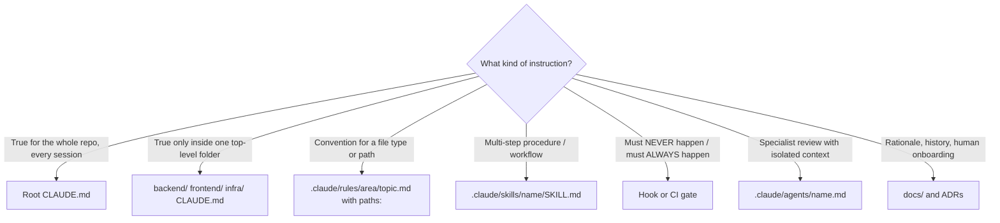

# AI Context Strategy

How this monorepo keeps AI sessions **lean, correct and scalable**. Decision: [ADR-0001](../adr/0001-monorepo-with-folder-scoped-context.md).
Tool sharing: [tool-parity.md](tool-parity.md).

## Principle: pay for context only when it is relevant

Every token loaded at session start is paid on every turn, and it dilutes attention. Official guidance for
Claude Code is to keep each `CLAUDE.md` under ~200 lines and to move anything that applies to only part of the
codebase into path-scoped rules or skills. `@imports` organise a file but do **not** reduce its cost, because
imported files load with their parent.

## The five context mechanisms (and what goes where)



| Mechanism | Loads | Budget | Example content |
|-----------|-------|--------|-----------------|
| Root `CLAUDE.md` | Every session | ≤150 lines | Stack, repo map, top commands (`just check`), branch/PR rules, pointers to folder CLAUDE.md files |
| Folder `CLAUDE.md` | On demand, when the agent reads files in that folder | ≤100 lines | Backend: layering, `uv run` commands, test layout. Frontend: layering, `pnpm` scripts, client generation |
| `.claude/rules/**.md` with `paths:` | When matching files are touched | ≤60 lines, one topic | `backend/python-style.md` (`backend/**/*.py`), `frontend/react-components.md` (`frontend/src/components/**`) |
| Skills | Description always; body only when invoked | SKILL.md ≤500 lines (target ≤200) | `new-api-endpoint`, `jira-story-to-spec` |
| Subagents | Only when delegated; separate context window | ≤100 lines | `code-reviewer`, `spec-verifier` |
| Hooks / CI | Never in context; deterministic | n/a | Format on edit; block edits to applied migrations |

**Rule of thumb:** if you would write "IMPORTANT" or "NEVER" in a markdown file, it probably belongs in a hook
or a CI gate. Instruction files are advisory; hooks and CI are enforced.

## Planned files

```text
CLAUDE.md                                   # ≤150 lines
backend/CLAUDE.md  frontend/CLAUDE.md  infra/CLAUDE.md
.claude/
  settings.json                             # permissions, hooks, enabledPlugins (committed)
  settings.local.json                       # personal (gitignored)
  rules/
    general/git-and-prs.md                  # paths: ["**"]; short
    backend/python-style.md                 # paths: ["backend/**/*.py"]
    backend/api-design.md                   # paths: ["backend/src/app/api/**", "backend/src/app/schemas/**"]
    backend/services.md                     # paths: ["backend/src/app/services/**"]
    backend/testing.md                      # paths: ["backend/tests/**"]
    backend/migrations.md                   # paths: ["backend/db/migrations/**", "backend/src/app/models/**"]
    frontend/typescript-style.md            # paths: ["frontend/**/*.{ts,tsx}"]
    frontend/react-components.md            # paths: ["frontend/src/components/**", "frontend/src/pages/**"]
    frontend/data-fetching.md               # paths: ["frontend/src/hooks/**", "frontend/src/services/**"]
    frontend/testing.md                     # paths: ["frontend/**/*.test.{ts,tsx}", "frontend/src/tests/**"]
    infra/iac.md                            # paths: ["infra/**"]
    ci/workflows.md                         # paths: [".github/workflows/**"]
  skills/<name>/SKILL.md                    # see skills-catalog.md
  agents/<name>.md                          # see subagents-hooks-mcp.md
  hooks/*.py                                # hook scripts (cross-platform Python)
CLAUDE.local.md                             # personal, gitignored
```

### Root `CLAUDE.md` outline (target ~100 lines)

1. **What this is:** two lines. Stack: one line per side.
2. **Repo map:** the folders, each with one line, plus "see `backend/CLAUDE.md`".
3. **Commands:** `just setup`, `just dev`, `just check` (all gates), `just test`, `just api-gen`.
4. **Workflow:** every change maps to a Jira key. Branch `feature/AIFS-0001/slug`. Spec at `docs/specs/AIFS-0001.md`.
   Use the `/implement-from-spec` skill.
5. **Definition of Done:** `just check` passes, coverage ≥80%, every AC has a test, docs and rules are updated
   when a convention changes.
6. **Do not:** edit generated `frontend/src/api/schema.d.ts`; edit applied Flyway migrations; commit `.env`.
   Hooks enforce these; the list is here so the agent doesn't waste a turn.
7. **Where to find more:** `docs/README.md`, [skills-catalog](skills-catalog.md). These are links, not imports.

## Session hygiene (team practice)

| Practice | Why |
|----------|-----|
| **One Jira story per session.** Run `/clear` before starting the next. | Stale context from the last task is the top cause of wrong edits |
| Launch Claude in the repo root for cross-cutting work, or in `backend/` or `frontend/` for focused work | Only the relevant folder CLAUDE.md and rules load |
| Use plan mode or a spec before any change touching more than ~3 files | Cheap to correct a plan; expensive to correct code |
| Delegate broad searches to subagents (the built-in Explore agent) | Their file dumps stay out of the main context |
| Use git worktrees for parallel stories | Isolated sessions, no cross-talk |
| `/compact` with a focus hint at natural breakpoints; otherwise prefer `/clear` plus the spec file as the hand-off | The spec file is a durable, human-reviewed summary |
| Promote personal learnings (auto memory, `CLAUDE.local.md`) to shared files **by PR**, using `/revise-claude-md` | Shared instructions stay reviewed |

## Scaling path

The v1 scale is one API, one SPA and a small team ([vision](../01-vision-and-scope.md#scale-assumptions)).
When the repo grows:

| Trigger | Action |
|---------|--------|
| A second backend service | `services/<name>/` with its own `CLAUDE.md`, `.claude/rules/<name>/`, and optional nested `services/<name>/.claude/skills/` (which load only for sessions in that subtree) |
| Root `CLAUDE.md` passes 150 lines | Move sections into folder CLAUDE.md files or rules; run `/doctor prompt-audit` |
| Teams that rarely touch each other's code | `claudeMdExcludes` in personal or team settings, so that one team's CLAUDE.md files don't load for the other |
| Shared conventions across many repos | Package rules and skills as an internal **Claude Code plugin** (marketplace), and keep only repo-specific rules in the repo |
| More than ~25 skills | Group by prefix (`be-`, `fe-`, `ops-`). Audit trigger overlap with the skill-creator eval. Move rarely used skills to plugins |
| Frontend shared libs | `packages/<lib>/` with a pnpm workspace; each package carries a small CLAUDE.md |
