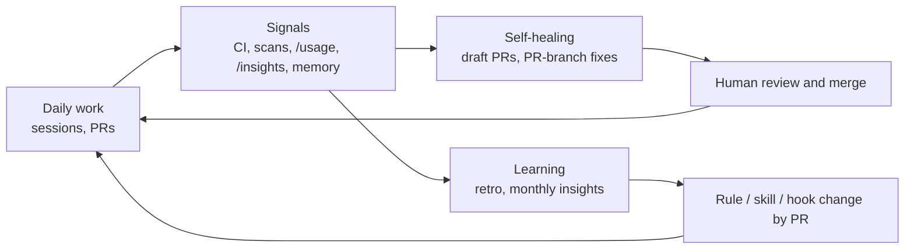

# The Self-Improving Loop

How the system **heals itself and gets better**: automation fixes what is mechanical, and what people learn
each day is turned into better rules, skills and habits. Decision: [ADR-0012](../adr/0012-self-healing-automation-boundaries.md).

## 1. Self-healing: automation that repairs (human merges)

The workflow `.github/workflows/claude-assist.yml` uses `anthropics/claude-code-action`. It is **dormant** until
you set the repository variable `CLAUDE_AUTOMATION_ENABLED=true` and store `ANTHROPIC_API_KEY` as a secret in the
`claude-automation` environment.

| Trigger | What it does | Bounds |
|---------|--------------|--------|
| `@claude` comment on a PR or issue | Answers or implements the request | Write-access users only; `--max-turns 15`; 20-minute timeout |
| A PR's CI run fails (same-repo branches only) | Diagnoses and pushes the smallest fix to **that PR branch**, or comments if unsure | Allowed tools limited to `just`, `uv`, `pnpm` and scoped `git`; `--max-turns 12` |
| Weekly (Monday) | Runs `just deps-check`; if it fails, opens a **draft PR** with minimal upgrades and the severity-based deadline | `--max-turns 20`; never merges |

### Autonomy ladder

| Level | Allowed | Status |
|-------|---------|--------|
| 0. Suggest | Comment with a diagnosis | Yes |
| 1. Fix a PR branch / open a draft PR | Push commits to a PR branch or open a draft PR | **Yes** |
| 2. Auto-merge | Merge without a human | **No.** Not allowed, even for patch bumps |

Guardrails: it never pushes to `main`, never approves or merges, never edits workflows or lockfiles by hand, and
never weakens a gate. CODEOWNERS and the required `gate` check still apply to every change it proposes. Treat CI
logs and PR text as untrusted input (prompt injection). Cap spend with `--max-turns`, job timeouts and a
workspace or key spend limit, and watch its cost in the [telemetry dashboards](usage-telemetry-and-chargeback.md).
Do not run it on fork pull requests; `workflow_run` executes with secrets.

For work you watch live, `/loop` with the repo's `.claude/loop.md` babysits your own PR in a session.

## 2. Learning: turning experience into better practice

| Source | Scope | What it gives you | Promotion path |
|--------|-------|-------------------|----------------|
| **Auto memory** | One developer, one repo (`~/.claude/projects/<project>/memory/`) | Corrections and preferences Claude noted | Review with `/memory`; promote the useful ones to a rule, skill or `CLAUDE.md` **by PR** (`/revise-claude-md`) |
| **`/insights`** | One developer, last ~200 local sessions | Friction points, misunderstood requests, suggestions | Monthly review; aggregated at the retro |
| **`/usage`** | One session or week | Which skills, subagents, plugins and MCP servers consume usage, with recommended fixes | Apply the fix suggestions; trim bloated instructions |
| **Telemetry** | Team | Cost per team, skill and PR; cache hit rate | Weekly dashboard review |
| **PR review comments** | Team | Repeated reviewer feedback | If a comment repeats, make it a rule or a lint |
| **Retro "AI friction"** | Team | Where the agent went wrong twice | Becomes a Jira task against a rule, skill or hook |

Auto memory stays **personal**. Nothing a model wrote privately becomes team policy without a reviewed PR.

## 3. The cadence

| When | Who | What |
|------|-----|------|
| Every session | Developer | `/clear` between stories; pick model/effort at the start |
| Every PR | Author + reviewers | `/pr-ready`; fix repeated review comments at the source |
| Daily | Developer | Glance at `/usage`; act on its top recommendation |
| Weekly | Tech lead | Dashboard review; triage the Monday security and maintenance runs |
| **Monthly** | Every developer, then the team | Run `/insights`; record 1 to 3 changes in the [insights review](../templates/insights-review.md); the team picks the top 3 improvements |
| Quarterly | Maintainers | Calibrate: routing table, budgets, skill evals, allowlists, advisor and agent-team policy |

**Gradual improvement rule:** change **one** thing per cycle, measure it for a month, then keep or revert. Gains
compound; big-bang rewrites hide which change helped.

## 4. How we know it is working

Compare these before and after each change (full scorecard in [00-start-here](../00-start-here.md#the-scorecard)):

- speed: lead time from story start to merge; PRs merged per developer per week
- quality: change failure rate, escaped defects, review rework, coverage held at 80% or more
- cost: cost per merged PR, cache hit rate, spend by team

Speed that raises defects, or savings that raise rework, are not improvements.
