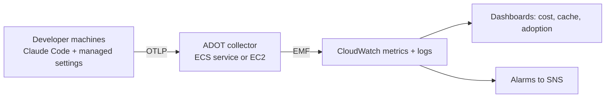

# Usage Telemetry and Team Chargeback

How to see **which team is spending what**, and whether the spend buys speed and quality. Source:
Anthropic's [monitoring usage](https://code.claude.com/docs/en/monitoring-usage) and
[costs](https://code.claude.com/docs/en/costs) documentation. Decision: [ADR-0011](../adr/0011-tiered-ai-operating-model.md).

## What Claude Code can tell you

OpenTelemetry metrics (exported per developer):

| Metric | Use |
|--------|-----|
| `claude_code.cost.usage` (USD) | Spend, with attributes `model`, `agent.name`, `skill.name`, `plugin.name`, `mcp_server.name`, `speed`, `effort` |
| `claude_code.token.usage` | Tokens by `type`: `input`, `output`, `cacheRead`, `cacheCreation` |
| `claude_code.session.count` | Sessions started (fresh, resume, continue) |
| `claude_code.pull_request.count`, `claude_code.commit.count` | Output, for cost per PR |
| `claude_code.lines_of_code.count`, `claude_code.active_time.total` | Activity |

Events (via the logs exporter) include `claude_code.api_request` with `cost_usd`, token counts and `duration_ms`.
Prompt and response **content is redacted by default**; keep `OTEL_LOG_USER_PROMPTS`, `OTEL_LOG_TOOL_DETAILS` and
`OTEL_LOG_RAW_API_BODIES` off unless security has approved them.

## Attributing cost to a team

Resource attributes become labels on every metric, so cost can be grouped by team and cost centre:

```text
OTEL_RESOURCE_ATTRIBUTES=department=engineering,team.id=platform,cost_center=eng-123
```

No spaces are allowed in values. Set `OTEL_METRICS_INCLUDE_REPOSITORY=true` to add the repository
(`vcs.repository.name`) so one team's several repositories can be separated.

> **Telemetry cannot be switched on from this repository.** Claude Code deliberately ignores exporter
> settings in `.claude/settings.json` so a cloned repo cannot enable or redirect telemetry. Deliver them with
> **managed settings** (admin console, MDM or `managed-settings.json`) so every developer gets the same
> `team.id`. An example is in [`examples/managed-settings.example.json`](examples/managed-settings.example.json).

## Pipeline on AWS (decision: CloudWatch via ADOT)



An example collector configuration is in [`examples/otel-collector.example.yaml`](examples/otel-collector.example.yaml).
The `awsemf` exporter and the temporality setting in it must be validated against the current ADOT documentation
before use; the file is an illustration, not a tested deployment. Build the collector, dashboards and alarms as
infrastructure code in milestone M5.

## Dashboards and alarms to build

| Panel | Definition |
|-------|-----------|
| Cost per day by `team.id` | Sum of `claude_code.cost.usage` |
| Cost by model, skill and subagent | Group by `model`, `skill.name`, `agent.name` (finds the expensive skill) |
| Cache hit ratio | `cacheRead / (cacheRead + cacheCreation + input)` from `token.usage` |
| Cost per merged PR | `cost.usage` divided by `pull_request.count`, per team and week |
| Adoption | Sessions and active time per team |
| Alarm: team daily cost | Above the agreed budget (start from the [guide's baselines](cost-and-context-optimization.md#budgets-and-alerts-starting-points)) |
| Alarm: cache hit ratio | Below target for three days |

Use the Claude Code `modelPricing` managed setting so cost figures use your **contracted rates** rather than list
price. It changes what Claude Code reports, not what Anthropic bills; the invoice remains authoritative.

## Which view you get depends on the access path

The access path is an [open decision](#open-decisions). It changes where authoritative numbers come from.

| Access path | Authoritative spend | Per-team attribution | Spend caps | Advisor available |
|-------------|--------------------|----------------------|------------|-------------------|
| Claude Team / Enterprise seats | Admin-console spend report and Enterprise Analytics API | Groups and spend limits in the console, plus OTel | Seat allowance, usage-credit limits per org, group or member | Yes |
| Anthropic API (Console) | Console usage page, Claude Code Analytics API | Workspaces, plus OTel | Workspace spend limits | Yes |
| Amazon Bedrock | AWS billing | **OTel or an LLM gateway only** | AWS budgets | **No** |

OpenTelemetry works on every path and is the only near-real-time per-user stream, which is why it is the common
layer in this design.

## Privacy and governance

- Telemetry carries an anonymous `user.id` and, when signed in, the account email: treat the dashboards as
  personal data and restrict access to team leads and finance.
- Report **team** trends to the team; do not rank individuals by spend. Use the data to fix prompts, skills
  and routing, not to police people.
- Collector credentials belong in the managed settings or the secret store, never in environment files or the repo.

## Open decisions

1. The **access path** (seats, API or Bedrock), which changes the authoritative source and the advisor.
2. **Who owns the managed settings** and the `team.id` values, and where the collector runs.
3. **Budgets per team** after the pilot, and who is notified when an alarm fires.
