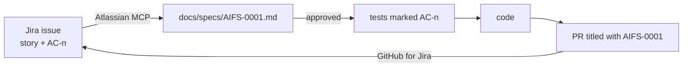

# Jira Spec-Driven Development

Jira is the **source of truth for requirements and acceptance criteria**. It is not just a task board. Every
code change traces back to a Jira issue, and every acceptance criterion traces forward to a test.



## Connectivity

- **Atlassian Rovo MCP server** (official, remote, OAuth per user) is configured in `.mcp.json` (Claude) and
  `.vscode/mcp.json` (Copilot). See [subagents-hooks-mcp.md](../03-ai-first/subagents-hooks-mcp.md#mcp-servers).
- The **GitHub for Jira** app links branches, commits, PRs, builds and deployments to issues automatically
  whenever the key appears in the branch name, commit or PR title.
- Jira automation rules move the issue to *In Progress* when a branch is created, to *In Review* when a PR is
  opened, and to *Done* when the PR is merged and deployed to staging.

## Issue types and templates

| Type | Template | Notes |
|------|----------|-------|
| Epic | Goal, success metric, scope | One per roadmap epic ([08-roadmap.md](../08-roadmap.md)) |
| Story | [templates/story.md](templates/story.md) | Must meet the DoR before *Ready* |
| Bug | [templates/bug.md](templates/bug.md) | Includes `request_id` from logs when available |
| Task / Spike | Free text + expected output | Spikes end in an ADR or a spec |

Paste the story template into the Jira **description** (or configure it as the default description for the
issue type). A consistent structure is what lets the `jira-story-to-spec` skill extract ACs reliably.

## Acceptance criteria format

- Gherkin style, **each with a stable ID**: `AC-1`, `AC-2`, … IDs never get renumbered. When an AC is removed,
  mark it `AC-3 (removed)`.
- One behaviour per AC, observable from outside (API response, UI state, persisted data).
- Non-functional requirements carry their own IDs: `NFR-1: p95 < 300 ms for GET /orders`.

```gherkin
AC-1: Given a signed-in user with 3 orders
      When they GET /api/v1/orders?status=shipped
      Then the response is 200 and lists only shipped orders, newest first
```

## Definition of Ready (story can enter a sprint)

- [ ] User story statement (as a / I want / so that)
- [ ] ACs in Gherkin with IDs; each one is testable
- [ ] API impact and DB impact marked (yes/no, with a sketch if yes)
- [ ] UX link attached if UI is involved
- [ ] Dependencies identified; no open questions
- [ ] Estimated

## Spec flow

1. `/jira-story-to-spec KEY` reads the issue via MCP and fills [templates/spec.md](templates/spec.md) into
   `docs/specs/KEY.md` with `status: draft`. Gaps go under **Open questions**. The agent never invents ACs.
2. A human reviews the spec. Fixes to *requirements* go into **Jira first**, then the spec is regenerated.
   Fixes to the *technical approach* go straight into the spec.
3. Setting `status: approved` unlocks `/implement-from-spec KEY`.
4. If the story changes mid-flight, update Jira, amend the spec, and note the change in the PR description.

## Traceability

| Link | Mechanism |
|------|-----------|
| Branch → issue | `type/AIFS-0001/short-slug` (see [git-and-code-review](../07-engineering-process/git-and-code-review.md#branching)) |
| Commit/PR → issue | Conventional commit with the key: `feat(orders): add status filter (AIFS-0001)` |
| AC → backend test | `@pytest.mark.ac("AIFS-0001", "AC-1")` (marker registered in `pyproject.toml`) |
| AC → frontend test | `describe("AIFS-0001")` / `it("AC-1: lists only shipped orders", …)` |
| Verification | The `spec-verifier` subagent, plus a CI job (M4) that posts an "AC coverage" table as a PR comment: every AC in the spec has a matching test |

## Definition of Done

- [ ] Every AC and NFR has at least one passing test that asserts the behaviour
- [ ] `just check` is green; CI gate is green; coverage ≥80% overall and on changed lines
- [ ] Spec, docs and rules are updated if a convention changed
- [ ] PR approved by a CODEOWNER; AI review comments resolved
- [ ] Deployed to dev and smoke-tested; the Jira issue is transitioned automatically
