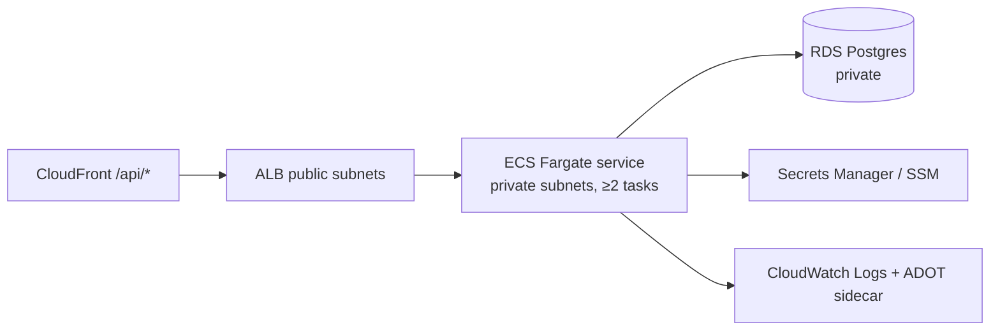
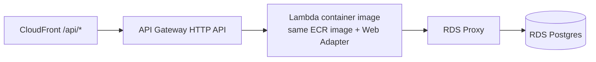

# Backend Deployment: Local, AWS Lambda, AWS ECS

Decision: [ADR-0006](../adr/0006-dual-backend-target-lambda-and-ecs.md). One image runs on both targets.

## Container image (`backend/Dockerfile`)

Multi-stage:

1. **builder:** `python:3.13-slim` + uv (copied from `ghcr.io/astral-sh/uv`), then
   `uv sync --locked --no-dev --no-install-project`, then copy `src/`, then `uv sync --locked --no-dev`.
2. **runtime** (target `runtime`: ECS, local, CI gate): `python:3.13-slim` pinned by digest. Copy `.venv` and `src/`, run as a non-root user,
   `ENV PATH=/app/.venv/bin:$PATH`.
3. **lambda** (target `lambda`): `FROM runtime`, plus one layer that copies the **AWS Lambda Web Adapter** extension
   into `/opt/extensions/` and sets `AWS_LWA_READINESS_CHECK_PATH=/health`. All other layers are shared with `runtime`.
   The adapter comes from public ECR, which rate-limits anonymous pulls on shared CI runners, so this target is
   built in the deploy pipeline (with retries) and not in the PR gate. Every base image is pinned by digest.
4. `CMD ["uvicorn", "--factory", "app.main:create_app", "--host", "0.0.0.0", "--port", "8000"]`. The factory
   form means importing the module never reads the environment.

ECR: scan on push, immutable tags, and a lifecycle policy that keeps the last N images.

## Local

| Mode | Command | Notes |
|------|---------|-------|
| Hot reload | `just dev-backend` → `uv run uvicorn --factory app.main:create_app --reload` | Postgres from `docker compose up db flyway` |
| Full stack in containers | `docker compose up` | Services `api`, `db` (postgres:16), `flyway` (runs migrate, then exits) |

## Option A: ECS Fargate (default for steady traffic)

- Task definition: the image digest, plus `secrets` from Secrets Manager or SSM (never plaintext env), and an
  `awslogs` log driver.
- Service: rolling deploy with the **deployment circuit breaker + rollback** on. ALB health check is
  `/ready`.
- Autoscaling: target tracking on CPU (~60%) and ALB requests per target.
- Migrations: a one-off `aws ecs run-task` using the `flyway/flyway` image (or the app image with Flyway
  baked in), in the same subnets and security group.

## Option B: Lambda (spiky or low traffic)

- Same image, deployed as a container-image Lambda. Uvicorn starts inside it, and the Web Adapter forwards
  events.
- **RDS Proxy** is required to avoid connection storms. Keep the SQLAlchemy pool small (`pool_size=1`,
  `max_overflow=0`) when `APP_RUNTIME=lambda`.
- Publish versions behind a `live` alias, which enables rollbacks. Add provisioned concurrency only if
  cold-start latency is an NFR.
- Limits to design around: 15-minute timeout, 6 MB sync payload, no long-lived WebSockets. Use ECS for those.
- Fallback: a zip deploy with `Mangum(app)`, documented but not the default.

## Choosing per project

| Need | Pick |
|------|------|
| Steady traffic, WebSockets, long requests, background workers | ECS |
| Spiky or low traffic, scale-to-zero cost | Lambda |
| Unsure | Start on Lambda in dev and ECS in prod; the same image makes switching an IaC variable |

## Other cloud providers

The image is a standard OCI container serving HTTP on `$PORT`. It runs unchanged on Azure Container Apps,
Google Cloud Run or Kubernetes. Only the IaC and the secret source differ.
