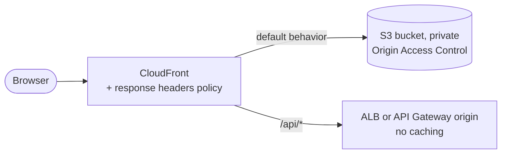

# Frontend Deployment: S3 + CloudFront

The SPA is static files (`frontend/dist/`) and can be served by any static host.

## AWS architecture

- The S3 bucket is **private** (Block Public Access on), and only CloudFront can read it through **Origin
  Access Control (OAC)**. Versioning is enabled.
- **SPA routing:** CloudFront custom error responses map 403/404 → `/index.html` (200). Alternatively, a
  CloudFront Function rewrites extension-less paths.
- **Same-origin API:** the `/api/*` behaviour forwards to the backend origin, with caching disabled and all
  headers and cookies forwarded. This removes CORS in deployed environments.
- **Security headers:** a response headers policy sets HSTS, CSP, `X-Content-Type-Options`, `Referrer-Policy`
  and frame options.
- TLS: an ACM certificate (us-east-1) and a Route 53 alias record.

## Caching

| Files | `Cache-Control` |
|-------|-----------------|
| `assets/*` (content-hashed by Vite) | `public, max-age=31536000, immutable` |
| `index.html`, `config.json` | `no-cache` |

## Deploy steps (in `cd.yml`)

1. Download the `dist/` artifact built on `main`.
2. Write `config.json` for the target environment (see below).
3. `aws s3 sync dist/assets s3://<bucket>/assets --cache-control "public,max-age=31536000,immutable"`
4. `aws s3 cp dist/index.html s3://<bucket>/index.html --cache-control "no-cache"` (and the same for
   `config.json`).
5. `aws cloudfront create-invalidation --paths "/index.html" "/config.json"`.
6. Smoke test: fetch `/`, then `/config.json`, then `/api/v1/health` through CloudFront.

## Environment configuration

To build once and promote the same artifact, **runtime config** is used instead of per-environment builds:

- `public/config.json` (local defaults) is replaced per environment at deploy time:
  `{ "apiBaseUrl": "", "env": "staging" }`. An empty `apiBaseUrl` means same-origin (CloudFront routes
  `/api/*` to the backend); other keys such as a RUM monitor ID are added when needed.
- `src/utils/config.ts` fetches it once at boot, before rendering.
- `VITE_*` build-time variables are reserved for values that are truly constant across environments.
- **No secrets, ever.** Everything shipped to the browser is public.

## Other providers

`dist/` + `config.json` deploys unchanged to AWS Amplify Hosting, Netlify, Vercel (static), Azure Static Web
Apps or Cloudflare Pages. Configure the SPA fallback to `index.html` and an `/api` proxy rule.
