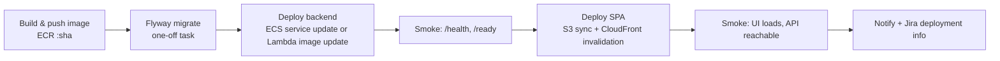

# Continuous Delivery and Environments

## Environments

| Env | Trigger | Approval | Purpose |
|-----|---------|----------|---------|
| `local` | `just dev` / `docker compose up` | — | Development |
| `dev` | Every merge to `main` | none | Integration; auto smoke tests |
| `staging` | Release PR merged (release-please creates tag `vX.Y.Z`) | none | Prod-like verification; E2E smoke |
| `prod` | Same tag, promoted | **GitHub Environment required reviewers** | Production |

Each AWS environment is ideally a **separate AWS account** (AWS Organizations), or at least separate VPCs with
separate IAM roles.

## Authentication: GitHub OIDC → AWS

- One IAM role per environment, assumed with `aws-actions/configure-aws-credentials` (`role-to-assume`).
- The trust policy restricts `token.actions.githubusercontent.com:sub` to
  `repo:<org>/<repo>:environment:<env>`. A workflow can only assume the prod role from a job bound to the
  `prod` GitHub Environment.
- No AWS access keys are stored anywhere in GitHub.

## Build once, promote everywhere

- The backend image is built once per commit on `main`, pushed to ECR as `<sha>`, and promoted by **digest**
  to staging/prod. It is never rebuilt.
- The frontend `dist/` is built once and uploaded as an artifact. Environment differences come from a runtime
  `config.json` ([aws-frontend.md](aws-frontend.md#environment-configuration)), not from rebuilding.

## `cd.yml` pipeline (per environment)

- Migrations run **before** the new code. Because they follow expand/contract, the old version stays
  compatible during the rollout.
- IaC changes run in their own job: `cfn-lint` + a CloudFormation **change set** summary is posted on the PR,
  and `aws cloudformation deploy` runs in `cd.yml` with environment approval ([ADR-0007](../adr/0007-iac-tool.md)).

## Rollback

| Component | How |
|-----------|-----|
| Backend (ECS) | Redeploy the previous task definition / image digest. The ECS deployment circuit breaker rolls back automatically when health checks fail |
| Backend (Lambda) | Point the alias at the previous version (published versions + `live` alias) |
| Frontend | Re-run the deploy job with the previous build artifact; S3 versioning is enabled as a backstop |
| Database | Forward-fix migration only ([ADR-0004](../adr/0004-flyway-over-alembic.md)) |

## Releases

- [release-please](https://github.com/googleapis/release-please) reads conventional commits on `main` and
  keeps a release PR open. Merging it creates the tag, the GitHub Release and `CHANGELOG.md`.
- v1 uses one version for the whole repo. When services multiply, switch to release-please manifest mode
  (per-package versions).
