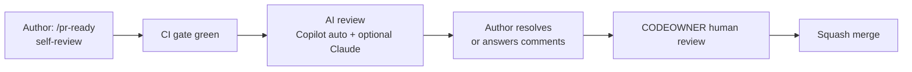

# Git Workflow and Code Review

## Branching

- **Trunk-based.** `main` is always deployable. Branches are short-lived (≤2–3 days).
- Branch name: `{type}/{KEY}/{slug}`, where:
  - `type` is one of `feature`, `fix`, `refactor`, `chore`, `docs`, `test`, `ci`, `hotfix`
  - `KEY` is the Jira key: the 4-letter project code `AIFS`, a hyphen and a 4-digit number (`AIFS-0001`)
  - `slug` is a concise kebab-case description
  - Example: `feature/AIFS-0042/order-status-filter`. The key sits in the middle, so the SessionStart hook
    and GitHub for Jira can parse it.
- Hotfixes follow the same flow, branched from `main`, with a fast-tracked review (see
  [bugs-and-issues.md](bugs-and-issues.md)).

## Commits and PR titles

- [Conventional Commits](https://www.conventionalcommits.org/) with the Jira key at the end:
  `feat(orders): add status filter (AIFS-0042)`, `fix(api): handle empty cursor (AIFS-0057)`.
- Types: `feat`, `fix`, `refactor`, `test`, `docs`, `chore`, `ci`, `build`, `perf`. Breaking changes use `!`
  or a `BREAKING CHANGE:` footer.
- Squash merges use the **PR title** as the commit, so the PR title must follow the same format. CI checks it.
- AI-assisted commits keep the tool's `Co-Authored-By` trailer for transparency. **The human author is
  accountable** for every line.

## PR template (`.github/pull_request_template.md`)

1. Jira link and spec link (`docs/specs/KEY.md`)
2. What changed and why (2–5 bullets)
3. AC → test mapping table (generated by `/pr-ready`)
4. Screenshots for UI changes
5. Checklist:
   - [ ] `just check` green locally
   - [ ] Every AC covered by a test; coverage ≥80% on changed lines
   - [ ] Migrations follow expand/contract; no edits to applied migrations
   - [ ] Changed a convention? Updated rule + CLAUDE.md + affected skills + docs
   - [ ] No secrets, no PII in logs

## Review process



| Step | Who | Focus |
|------|-----|-------|
| Self-review | Author (and the `code-reviewer` / `spec-verifier` subagents) | Gates, AC coverage, diff hygiene |
| AI review | Copilot code review; Claude action (optional) | Bugs, edge cases, conventions, security smells |
| Human review | CODEOWNER | **Business logic vs ACs**, design, naming, maintainability, test *quality*. Don't re-check what the gates already enforce |

### Approval rules

| Path | Required approvals |
|------|--------------------|
| Default | 1 CODEOWNER |
| `infra/**`, `.github/workflows/**`, `.claude/**`, `CLAUDE.md`, `backend/db/migrations/**` | 2 (including the area owner) |

### Norms

- PR size: aim for ≤400 changed lines, excluding generated files and lockfiles. Split larger work.
- First review within 1 business day.
- Reviewers label comments `blocking:`, `suggestion:` or `nit:`.
- Reviewing AI-written code: read the tests first. Would they fail if the behaviour were wrong?

## CODEOWNERS (`.github/CODEOWNERS`, illustrative)

```text
*                                 @org/maintainers
/backend/                         @org/backend
/frontend/                        @org/frontend
/infra/  /.github/workflows/      @org/devops @org/maintainers
/backend/db/migrations/           @org/backend @org/maintainers
/CLAUDE.md /**/CLAUDE.md /.claude/ /.github/copilot-instructions.md /.mcp.json  @org/maintainers
/docs/adr/                        @org/maintainers
```

Replace the teams with real GitHub teams when you scaffold the repo.
