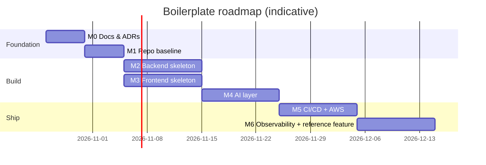

# Roadmap and Milestones

Each milestone is a **Jira epic**, and each line below is a **story** ready to paste into Jira, with its
acceptance criteria shortened to one line. Expand them into full Gherkin with the
[story template](04-spec-driven-development/templates/story.md). The key prefix `BP` is a placeholder for the
Jira project key.

Sizing assumption: 2-week sprints, 2–4 developers. M2 and M3 can run in parallel.

## M0: Blueprint docs and decisions (this work)

**Exit:** all docs `status: accepted`; ADR-0005 and ADR-0007 decided.

- AIFS-0001 **Review blueprint.** AC: every row in the traceability matrix points to an accepted doc.
- AIFS-0002 **Decide ADR-0005 (TanStack Query).** AC: ADR status is Accepted, and the frontend docs are updated.
- AIFS-0003 **Decide ADR-0007 (IaC tool).** AC: ADR status is Accepted, and the delivery docs are updated.
- AIFS-0004 **Create the Jira project.** AC: issue types, story/bug templates, workflow statuses, DoR/DoD and
  automation rules are configured as in [jira-workflow.md](04-spec-driven-development/jira-workflow.md).

## M1: Repository baseline

**Exit:** a fresh clone runs `just setup` on Windows, macOS and Linux, and a docs-only PR passes `gate`.

- AIFS-0010 **Root files.** AC: README, CONTRIBUTING, LICENSE, CODEOWNERS, `.editorconfig`, `.gitattributes`
  (LF), `.gitignore`, `.nvmrc` and the `justfile` exist per [09-scaffold-spec.md](09-scaffold-spec.md).
- AIFS-0011 **VS Code baseline.** AC: opening the repo prompts for the recommended extensions, and Python/TS
  format on save works.
- AIFS-0012 **pre-commit.** AC: `just setup` installs the hooks; a commit with a bad message or a secret is
  rejected.
- AIFS-0013 **Repo CI skeleton.** AC: `ci.yml` + `_repo.yml` run markdownlint, gitleaks and actionlint; `gate` is
  the required check on `main`.
- AIFS-0014 **Rulesets.** AC: branch protection matches [ci.md](06-delivery/ci.md#branch-protection-repository-ruleset-on-main).

## M2: Backend skeleton and gates

**Exit:** `just check-backend` is green with coverage ≥80%; the reference health endpoints work locally and in
Docker.

- AIFS-0020 **uv project.** AC: `pyproject.toml` has all tool configs from [05-quality-gates.md](05-quality-gates.md#backend); `uv sync --locked` works.
- AIFS-0021 **App factory + core.** AC: `create_app()`, settings, JSON logging, the request-id middleware and the
  error envelope exist, and each is tested.
- AIFS-0022 **DB + Flyway.** AC: `docker compose up db flyway` applies `V…__init.sql`; the async session dependency
  works; the drift test passes.
- AIFS-0023 **Health/ready.** AC: `/health` returns 200 with the version; `/ready` returns 503 when the DB is down.
- AIFS-0024 **Test harness.** AC: Testcontainers Postgres fixture, transactional session, `ac` marker registered,
  `httpx` async client fixture.
- AIFS-0025 **Dockerfile.** AC: multi-stage, non-root image runs uvicorn; the image contains the Lambda Web
  Adapter; Trivy reports no criticals.
- AIFS-0026 **Backend CI.** AC: `_backend.yml` runs lint/type/test/contract/image; a failing gate fails `gate`.

## M3: Frontend skeleton and gates

**Exit:** `just check-frontend` is green with coverage ≥80%; the app renders a page that calls `/health`.

- AIFS-0030 **Vite + TS strict + React Router.** AC: `pnpm dev` serves the app; `tsc --noEmit` passes with strict
  flags.
- AIFS-0031 **Lint/format.** AC: the ESLint flat config and Prettier from the gates doc; layering is enforced by
  `no-restricted-imports`.
- AIFS-0032 **Typed API client.** AC: `pnpm api:gen` generates `src/api/schema.d.ts` from the committed
  `openapi.json`; CI fails when it is stale.
- AIFS-0033 **Test harness.** AC: Vitest + RTL + MSW set up; `renderWithProviders`; coverage thresholds at 80.
- AIFS-0034 **Runtime config.** AC: `config.json` is loaded before render; the app fails gracefully if it is
  missing.
- AIFS-0035 **Frontend CI.** AC: `_frontend.yml` runs lint/type/test/client/build.

## M4: AI layer

> **Status:** largely built on branch `feature/AIFS-0040/ai-layer-and-cost-governance`: `CLAUDE.md` tree, 9 path-scoped rules, 3 hooks, 3 subagents, 6 skills, AI-config lint, `/loop` prompt, dormant Claude automation, and the cost, telemetry, agent and self-improving-loop design docs. **Remaining:** the Jira MCP connection test, a Copilot parity smoke test, `generate-tests` / `new-react-component` / `bugfix-from-jira` skills, skill evals, and the `ai-enablement/` examples.

**Exit:** a developer completes the W1 workflow ([playbook](03-ai-first/ai-workflows-playbook.md)) on a sample
story in both Claude Code and Copilot.

- AIFS-0040 **CLAUDE.md tree.** AC: root ≤150 lines, folder files ≤100, matching the outlines in
  [context-strategy.md](03-ai-first/context-strategy.md).
- AIFS-0041 **Rules.** AC: every rule file in the planned list exists with `paths:`, ≤60 lines; Copilot shows
  them as applied for matching files.
- AIFS-0042 **Hooks + permissions.** AC: editing an applied migration or `.env` is blocked; edited files are
  auto-formatted; the SessionStart hook prints the story/spec.
- AIFS-0043 **MCP.** AC: `.mcp.json` and `.vscode/mcp.json` connect to Jira through OAuth; no credentials are
  committed.
- AIFS-0044 **Workflow skills.** AC: `jira-story-to-spec`, `implement-from-spec` and `pr-ready` pass the trigger
  and output evals.
- AIFS-0045 **Scaffolding skills.** AC: `new-api-endpoint`, `new-db-migration`, `new-react-page` and
  `new-react-component` produce code that passes `just check` without manual edits.
- AIFS-0046 **Quality skills.** AC: `generate-tests`, `quality-gate` and `bugfix-from-jira` pass their evals.
- AIFS-0047 **Subagents.** AC: `code-reviewer`, `spec-verifier`, `test-gap-finder` and `security-reviewer`
  exist, use read-only tools and are invocable from both tools.
- AIFS-0048 **Copilot parity.** AC: the copilot-instructions pointer is ≤30 lines; VS Code flags are set;
  `just check` is the single command Copilot agent mode uses.
- AIFS-0049 **AI-config lint + AC-coverage CI.** AC: CI enforces the size and name budgets; the PR comment lists
  each AC → test.
- AIFS-0052 **Vulnerability management.** AC: `security.yml` runs weekly and `_security.yml` on every PR; the
  Wiz connector or CLI is configured per your organisation; Dependabot alerts and security updates are enabled; the open
  decisions in [vulnerability-management.md](07-engineering-process/vulnerability-management.md#open-decisions) are answered.
- AIFS-0051 **AI access governance.** AC: `.github/ai-policy.json` and the CI check exist; the open decisions in
  [ai-access-governance.md](03-ai-first/ai-access-governance.md#open-decisions) are answered; organisation-managed
  settings for Claude and Copilot are configured.
- AIFS-0050 **ai-enablement examples.** AC: examples 01–06 exist per the scaffold spec.

## M5: CI/CD and AWS

**Exit:** a merge to `main` deploys to dev automatically; a tag promotes to staging, then prod with approval.

- AIFS-0060 **IaC foundation.** AC: CloudFormation stacks (network, ECR, GitHub OIDC roles per environment); `cfn-lint` runs and a change set is posted
  on PRs.
- AIFS-0061 **Backend on ECS.** AC: Fargate service behind an ALB; secrets from Secrets Manager; circuit-breaker
  rollback.
- AIFS-0062 **Backend on Lambda.** AC: the same image deploys as a Lambda behind an HTTP API with RDS Proxy; the
  target is selectable by a variable.
- AIFS-0063 **RDS + migrations.** AC: Flyway runs as a one-off task before the app deploys; a failure stops the
  pipeline.
- AIFS-0064 **Frontend hosting.** AC: private S3 + CloudFront OAC, SPA fallback, `/api/*` behaviour, security
  headers, cache policy.
- AIFS-0065 **cd.yml.** AC: build once and promote by digest; smoke tests; the Jira deployment info is visible.
- AIFS-0066 **Releases.** AC: release-please opens release PRs; a tag triggers the staging → prod promotion.

## M6: Observability and reference feature

**Exit:** a dashboard and alarms exist per environment; one real feature was delivered end to end through
spec-driven development.

- AIFS-0070 **Tracing.** AC: OTel → ADOT → X-Ray traces show the API + DB spans; the trace ID appears in logs.
- AIFS-0071 **Dashboards + alarms.** AC: the alarms from [observability.md](06-delivery/observability.md#alerting)
  exist in IaC and notify SNS.
- AIFS-0072 **Frontend RUM.** AC: CloudWatch RUM captures errors and web vitals in dev.
- AIFS-0073 **Runbooks.** AC: `docs/runbooks/` has one runbook per alarm, plus the incident review template.
- AIFS-0074 **Reference feature** (e.g. "Items CRUD with status filter"). AC: built only through W1; every AC has
  a test; the example is recorded in `ai-enablement/examples/01-story-to-pr/`.
- AIFS-0075 **Retro + v1.0.0.** AC: the AI-friction findings are applied to the rules/skills; `v1.0.0` is tagged.

## Later (candidates)

Auth (Cognito/OIDC) · Playwright E2E smoke tests in CI (post-v1) · background workers (SQS + ECS) · AppConfig feature flags ·
internal Claude Code plugin for cross-repo skills · multi-service monorepo layout.
